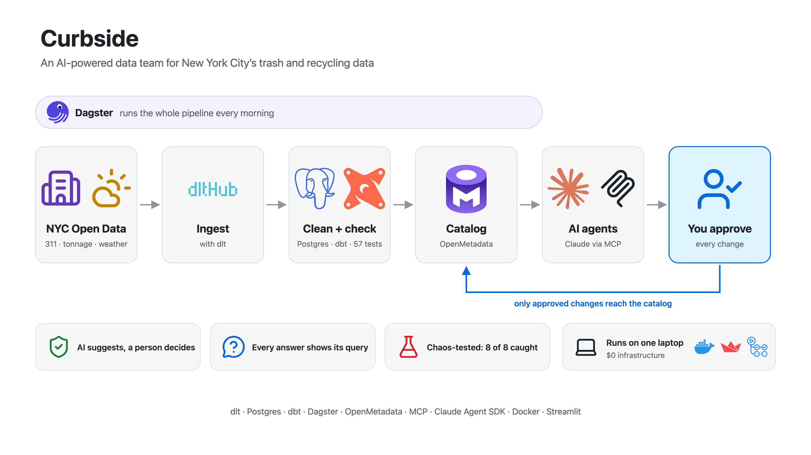
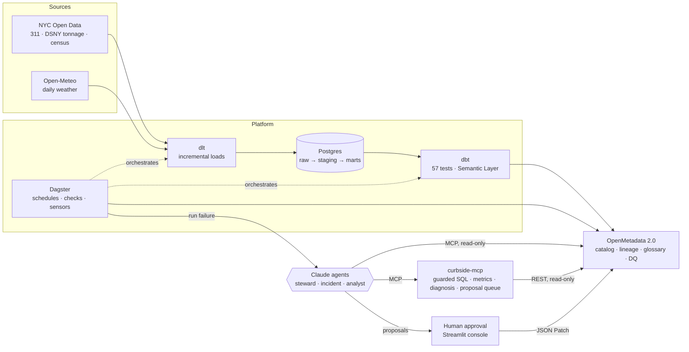
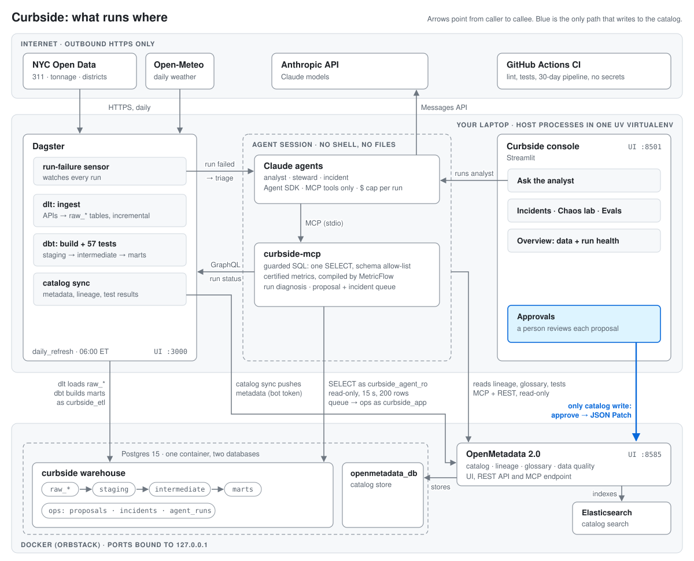

# Curbside

**An AI-native, metadata-driven data platform for NYC sanitation data.**



Curbside ingests NYC Department of Sanitation (DSNY) collection tonnage and 311 sanitation
complaints and models them with dbt. Dagster orchestrates the pipeline, and **OpenMetadata**
catalogs it. OpenMetadata also serves as the shared memory for three Claude agents:

- a **steward** that documents the catalog and finds personal data,
- an **incident responder** that traces broken pipelines to their root cause,
- an **analyst** that answers questions only from certified metrics.

Agents *read* metadata (lineage, glossary, tiers, test results) through MCP and *propose*
changes back. A person approves every change before it reaches the catalog. A chaos
harness breaks the pipeline on purpose to prove the incident agent works.

Everything runs locally on a 16 GB laptop at $0 infrastructure cost.



### What runs where



Everything runs on one laptop. Dagster, dbt, dlt, the agents and the console are host
processes in one uv virtualenv; Postgres, OpenMetadata and Elasticsearch run in Docker with
ports bound to 127.0.0.1. The only outbound traffic is HTTPS to the two open-data APIs and
the Anthropic API. Agents read the catalog but can't change it: the one write path is a
person approving a proposal in the console, which applies a JSON Patch.

## Why it's built this way

| Decision | Why |
|---|---|
| **OpenMetadata without Airflow** | Ingestion runs through the `metadata` CLI, triggered by Dagster. That saves ~2 GB of RAM, and OpenMetadata is deprecating its internal Airflow in 2.1 anyway. The full catalog stack uses ~3 GB. |
| **One asset-key convention: `[schema, table]`** | Dagster wires dlt → dbt lineage automatically, and OpenMetadata's Dagster connector stamps every lineage edge with the job that produced it. Lineage in the catalog runs from **API endpoint → raw → staging → marts**, down to column level. |
| **Governance as code** | The domain, a 10-term business glossary, owners, tiers and the data product are seeded idempotently. dbt `meta.openmetadata` blocks link columns to glossary terms. |
| **Agents propose, humans approve** | OpenMetadata's MCP write tools are disallowed for agents, and a PreToolUse hook denies them a second time. Agents can only queue proposals. Approval builds a JSON Patch against the live entity. |
| **Three layers of SQL safety** | 1. A sqlglot guard walks the whole syntax tree, because `WITH x AS (DELETE…)`, `SELECT … INTO` and `FOR UPDATE` all parse as SELECT. 2. A read-only Postgres role with forced read-only transactions. 3. A statement timeout plus a row cap. Each agent also gets its own schema scope. |
| **Certified metrics through the dbt Semantic Layer** | MetricFlow compiles the metric request and the read-only role executes it, so the analyst never hand-writes SQL for a certified number. |
| **Chaos engineering for data** | Eight reversible upstream faults (schema drift, tons→pounds, duplicates, partial month, broken reference data, stale feed, null spike, renamed complaint type), each with ground truth. |

## What's in the box

| Layer | Tech | Highlights |
|---|---|---|
| Ingestion | dlt 1.30 | 311 loads incrementally on Socrata's `:updated_at` and merges on `unique_key`, so status changes overwrite earlier rows. ~609k DSNY requests since 2025, ~13k changed per day. |
| Warehouse | Postgres (inside the OpenMetadata container) | Least-privilege roles: ETL, app, read-only agent, catalog reader |
| Transform | dbt 1.12 | staging → intermediate → marts, 57 data tests (4 custom anomaly tests), incremental 311 fact, MetricFlow semantic layer with 9 metrics |
| Orchestration | Dagster 1.13 | dlt + dbt assets, dbt tests as asset checks, daily schedule, run-failure sensor → incident agent |
| Catalog | OpenMetadata 2.0.2 | Tables, column lineage, dbt tests with results, glossary, tiers, domain, data product, Dagster pipelines, profiler |
| MCP | OpenMetadata MCP (15 tools) + **curbside-mcp** (MCP SDK v2) | `run_readonly_sql`, `query_metric`, `diagnose_asset`, `get_run_failure`, `impact_of_change`, `propose_metadata_change`, `record_incident` |
| Agents | Claude Agent SDK, `claude-opus-5` | MCP-only (no shell or files), isolated from user settings, budget and turn caps, JSONL traces, cost logged per run |
| App | Streamlit | Ask the analyst · Incidents · Approvals · Chaos lab · Agent evals |

## Results

- **Data quality coverage: 8/8 injected faults are caught by the test suite.** Closing
  the gaps took three new anomaly tests: tonnage scale jumps, feed recency, and a
  "missed collections disappeared" check. This runs in CI.
- **Real upstream issues surfaced:** 7 311 requests closed before they were opened, and
  community board codes that don't map to residential districts (`0 Unspecified`, parks
  and airports). Both are handled and documented.
- **Agent evals** (`make eval-*`; reports in [`evals/reports/`](evals/reports/)):
  - Incident agent: root-cause accuracy over the 8 chaos faults.
  - Analyst: 15 golden questions scored against live reference SQL.
  - Steward: PII precision and recall compared with OpenMetadata's built-in
    auto-classifier.

## Quickstart

Requirements: macOS or Linux, Docker (OrbStack recommended on Mac), [uv](https://docs.astral.sh/uv/), 16 GB RAM.

```bash
make setup      # containers, Python envs, bot token, 311 backfill, dbt build, catalog sync (~15 min)
make dagster    # orchestration UI  → http://127.0.0.1:3000
make app        # Curbside console  → http://localhost:8501
open http://localhost:8585   # OpenMetadata (admin@open-metadata.org / admin)
```

Add `ANTHROPIC_API_KEY` to `.env` to enable the agents, then:

```bash
make ask Q="Which borough diverts the most waste?"
make steward && make proposals && make approve ID=1
make chaos FAULT=unit_change_tonnage   # the failure sensor calls the incident agent
make chaos-restore
```

`.mcp.json` also wires both MCP servers into Claude Code. Export `OPENMETADATA_JWT_TOKEN`
from `.env`, run `claude` in the repo, and ask it to "diagnose marts.fct_monthly_tonnage".

## Repository map

```
infra/          OpenMetadata 2.0.2 compose (vendored) + override, Postgres bootstrap, ingestion workflows
ingestion/      dlt sources: NYC Open Data (Socrata), Open-Meteo
transform/      dbt project: models, tests, seeds, semantic layer
orchestration/  Dagster assets, jobs, schedules, failure sensor, agent jobs
governance/     governance as code, catalog sync, proposal review
mcp_servers/    curbside-mcp: tools, SQL guard, tests
agents/         steward / incident / analyst agents and their prompts
evals/          chaos faults, detection check, golden questions, PII labels, runners, reports
app/            Streamlit console
docs/           architecture notes, research notes, demo script
```

## Data

Public data from [NYC Open Data](https://opendata.cityofnewyork.us/) (311 Service
Requests `erm2-nwe9`, DSNY Monthly Tonnage `ebb7-mvp5`, Population by Community District
`xi7c-iiu2`) and [Open-Meteo](https://open-meteo.com/). This is an independent portfolio
project. It is not affiliated with or endorsed by the City of New York or DSNY.
