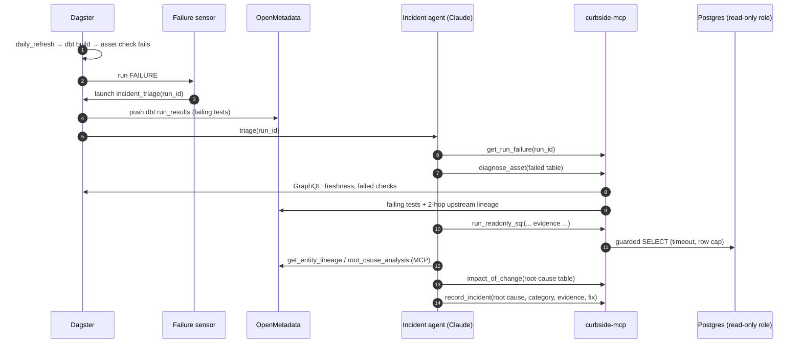
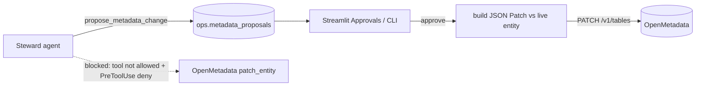

# Architecture

## Incident flow

## Metadata write path (human in the loop)

## Security model

| Layer | Control |
|---|---|
| Agent runtime | No built-in tools (`tools=[]`); `setting_sources=[]`; `strict_mcp_config`; explicit MCP tool allow-list; `permission_mode="dontAsk"` so unlisted tools are refused |
| Catalog writes | OpenMetadata write tools are in `disallowed_tools` and denied again by a PreToolUse hook. Agents can only queue proposals. |
| SQL | sqlglot tree-walk guard (single read-only query, no write or lock nodes, no dangerous functions, schema allow-list per agent) → `curbside_agent_ro` role with `default_transaction_read_only=on` and a 15 s timeout → server-side cursor with a row cap |
| Credentials | The agents never see a DSN or token. MCP servers hold them. OpenMetadata access goes through the bot JWT. |
| Prompt injection | Every prompt states that tool output is data, not instructions. Sensitive values are summarized, not copied, into proposals. |
| Cost | `max_budget_usd` and `max_turns` per agent. Every run is logged to `ops.agent_runs`. The steward schedule is off by default. |

## Per-agent scope

| Agent | curbside-mcp tools | OpenMetadata MCP tools | SQL schemas | Effort |
|---|---|---|---|---|
| Steward | run_readonly_sql, propose_metadata_change, list_pending_proposals | read tools | marts, staging, intermediate | medium |
| Incident | get_run_failure, diagnose_asset, run_readonly_sql, impact_of_change, record_incident | read tools | marts, staging, intermediate, raw_* | high |
| Analyst | list_metrics, query_metric, run_readonly_sql | search_metadata, get_entity_details | marts | medium |

All agents default to `claude-opus-5` with adaptive thinking. Override per agent with
`CURBSIDE_<AGENT>_MODEL` / `CURBSIDE_<AGENT>_EFFORT`.

## Memory budget (measured)

| Container | RSS |
|---|---|
| openmetadata_server | ~1.1 GB |
| openmetadata_elasticsearch | ~1.7 GB |
| openmetadata_postgresql (OpenMetadata + warehouse) | ~0.25 GB |

Dagster, dbt, dlt and the agents run natively in uv virtualenvs.
